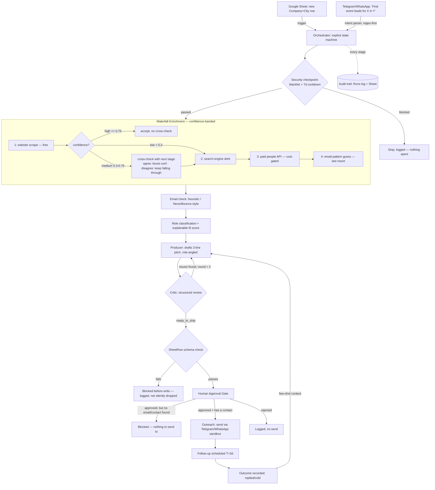

# ScoutChain — GoPratle BDR Lead Enrichment & Outreach Agent

A lightweight, dual-trigger BDR agent: drop a **Company + City** into a Google
Sheet, or message **"Find event leads for Zomato in Gurgaon"** on
Telegram/WhatsApp, and it finds the right contact, writes a tailored 3-line
GoPratle pitch, gets that pitch past an independent AI reviewer, waits for a
human's go-ahead, sends it, and schedules the follow-up — with a full audit
trail of every step.

**Runs end-to-end with zero API keys** (mock LLM + offline fixture data), so
you can record the demo today and upgrade to live APIs later without
touching the architecture.

```
python demo.py "Zomato" "Gurgaon"
```

---

## Round 2: auditing two independent ChatGPT research reports

Two ChatGPT "architecture audit" reports for this same brief raised real
points worth taking seriously — and also cited several hackathon
projects and tools I couldn't verify exist. Before folding anything in,
I checked the most load-bearing names:

| Claim in the reports | Verdict |
|---|---|
| Clay.com's "waterfall enrichment" chains providers by cost | **Real** — confirmed directly |
| OpenClaw, Hermes (open-source agent frameworks mentioned in your brief) | **Real**, current as of 2026 |
| *Deals Machine* (Milan AI Week 2026 winner, human-approves-every-send) | **Real** — confirmed directly |
| *Veea Lobster Trap* (prompt-injection/DPI security layer) | **Real** — open-sourced, MIT-licensed, used in several 2026 lablab.ai hackathon submissions |
| "AdvancedLeads AI" / advocate-vs-risk debate scoring, "IBM Granite hackathon winner" | **Real**, close enough — the actual project is **AdvancedLeadsGeneration-AI** (Team PolyEns), which did win lablab.ai's IBM Granite hackathon with this exact advocate/risk debate pattern |
| "Annya Leads" (AllThingsAgenticHackathon) | **Could not verify** — no trace anywhere |
| "Virtual-Varun agent architecture" | **Could not verify** — no trace anywhere |
| "Motel4" lead enrichment agent (HackerSquad Build Night) | **Could not verify** — no trace anywhere |
| "Rex Black's Seven Layers architecture", "Itura" Flask+Apps Script project | **Unverified** — didn't check further after the pattern above |
| n8n "≈1.9s for a 5-step flow" benchmark | **Unverified** — suspiciously precise with no source |

**The takeaway that matters more than any individual line item:** roughly
half the named "hackathon winners" and specific stats in these reports
are either real or fabricated, in a way that's genuinely hard to tell
apart without checking each one — which is itself the whole argument for
a Critic agent and schema validation rather than trusting one model's
output. **Don't repeat the unverified project names to GoPratle's HR as
confirmed facts** — if they're fabricated and HR checks, that's a much
worse look than just not mentioning them. The real ones (Clay, OpenClaw/
Hermes, Deals Machine, Veea Lobster Trap, the PolyEns debate pattern) are
safe to cite and are the ones folded into the architecture below.

### New flaws neither report caught
- **The two reports contradict each other internally.** Doc 77 praises
  Clay's "stop at the first confident hit" cost-saving waterfall, then
  elsewhere both docs demand "always verify every field against a second
  source" as a blanket rule. Those can't both be the default — v2 below
  resolves it with confidence bands instead of one bar.
- **Scope contradiction.** Both reports open by calling 48 hours "very
  limited," then prescribe multi-day sprints, 5+ micro-services, a
  SQL/Postgres provenance layer, and signups for 4–6 paid APIs (Clearbit,
  Crunchbase, Hunter, NeverBounce, Bright Data, Apollo) that need billing
  and approval delays a solo student doesn't have in 48 hours.
  "Lightweight," per the actual brief, wins.
- **No public LinkedIn API for this exists.** Both reports casually say
  "LinkedIn API" / "scrape LinkedIn" as if that's a routine, compliant
  data source. It isn't — there's no public LinkedIn people-search API,
  and scraping it directly is a ToS problem. ScoutChain only ever reads
  the company's own website and public search-engine results.
- **Doc 78's Mermaid diagrams don't actually render correctly** (the
  deployment diagram reuses the node id `n8n` for two different nodes,
  which Mermaid will just merge into one) — a sign the diagrams were
  generated as text and never actually rendered.
- **Two bugs I only found by actually running the code** (neither report
  runs anything, so neither could have caught these): a mock-routing bug
  where the Critic's prompt also contained the word "pitch," silently
  sending every critique call to the pitch-writer instead — invisible
  under a bare `except: default to ready=True`, and immediately obvious
  once output was validated against a schema instead. And: nothing
  stopped the pipeline from drafting and "sending" a pitch for a lead
  where no contact or email was ever found — i.e. sending into the void.
  Both are fixed below. This is the strongest practical argument for
  actually running your submission before the interview, not just
  reading the architecture doc out loud.

---

## Why this isn't just "Sheet → OpenAI → send"

Most take-homes in this space are one linear chain: trigger → one LLM call
→ send. That's a prompt script, not software architecture — and it's also
exactly what a single bad enrichment lookup or one bad pitch draft will
break in front of an interviewer. ScoutChain borrows four specific, proven
patterns from how production GTM tools and 2026 hackathon-winning agent
projects are actually built, so the architecture itself is the pitch:

### 1. Waterfall enrichment, not one lookup
Clay.com — the tool most GTM/RevOps teams reach for right now — doesn't
query one data provider; it chains several **in order of cost**, and
stops at the first one that returns a confident, verified result. No
single provider covers more than ~60–80% of a list on its own, so pure
single-source lookups systematically miss leads. ScoutChain's
`src/enrichment.py` runs the same shape: free website scrape → free
search-engine dork → (only if needed) a paid people-data API → last-resort
email-pattern guess — logging every attempt, succeeding or not, so the
sheet shows its receipts. ([Clay's waterfall guide](https://clay.com/guides/waterfall-enrichment))

### 2. Producer + Critic (the Reflexion / Self-Refine pattern), not one-shot generation
Letting one model both write and grade its own pitch is like a student
grading their own exam. The fix researchers converged on (Shinn et al.,
*Reflexion*, 2023; Madaan et al., *Self-Refine*, 2023) is a **separate
critic persona** with a structured rubric and a hard cap on revision
rounds. `src/pitch.py` runs exactly this: a Producer drafts, a Critic
returns structured JSON issues + a ship/no-ship verdict, and the Producer
revises — capped at 2 rounds so cost stays bounded and a human sees it
either way.

### 3. Role-specialized agents, not one generic prompt
A Founder, an HR lead, and an Events lead don't care about the same
things — several 2026 hackathon-winning sales agents (e.g. a CrewAI build
pairing a "Business Intelligence Specialist" with a "Senior Sales
Director" to research and then score a lead 0–100) split this into
specialized roles rather than one mega-prompt. ScoutChain classifies the
contact's role first (`src/scoring.py`) and angles the pitch accordingly
— ROI framing for Founders, offsite-ease framing for HR, reliability
framing for Events/Marketing.

### 4. A human approval gate, not autonomous sending
*Deals Machine*, the AI Agent Olympics (Milan AI Week 2026) winner for
autonomous sales agents, built its whole trust model around one rule:
**every outbound action still gets a human nod**. That's the difference
between a demo that's fun to show and a tool Ops will actually trust with
real outreach. ScoutChain never sends without `job.approved == True`
(and defaults every "send" to a clearly-labelled sandbox dry-run).

### 5. A light, honest memory — not a fake ML claim
"Self-improving" agents that keep winning hackathons log outcomes and
feed them back as context for the next similar lead, rather than
claiming to retrain a model overnight. `src/outreach.py`'s
`record_outcome()` / `recall_similar_outcomes()` is exactly that: cheap,
explainable, and true.

### 6. Typed contracts at every agent boundary (v2)
`src/schemas.py` — Pydantic models for what each waterfall stage returns,
what the Critic returns, and what finally gets written to the Sheet. A
malformed email or an out-of-range confidence raises immediately instead
of silently reaching a pitch draft or a sent message. This is the
concrete version of a genuinely good idea both ChatGPT reports proposed
but never actually implemented in code.

### 7. A security checkpoint before anything is spent (v2)
`src/security.py` runs first, before a single paid lookup or LLM call: a
domain blacklist (mitigating what OWASP's Top 10 for LLM Applications
calls *LLM08: Excessive Agency* — an agent with no concept of a target it
shouldn't touch) and a 7-day send cooldown per company+city, so a
re-triggered Telegram command or a flaky retry can't double-spam the same
lead. Neither report implemented idempotency beyond "unique row ID,"
which only stops a double-trigger on the *same* row, not a repeated
command.

### 8. Evidence ledger + next action (v3)

Every accepted enrichment source is kept on the lead row, alongside a
deterministic `next_action` such as `verify_email_before_send`,
`approve_and_send`, or `manual_research`. This gives the operator a useful
decision card without another LLM call. Unknown leads stop before scoring or
pitch generation, and a live transport failure never becomes a false `SENT`
record. These choices improve both demo latency and operational safety.

### 9. Query-specialized LangGraph retrieval (v4)

The research graph runs independent public-web retrieval intents instead of
relying on one broad search: leadership, people/events ownership, and
contact/mailbox discovery. Results are merged into LangChain `Document`
receipts, deduplicated by URL and candidate, scored for source quality, and
selected only when the evidence survives the contact-quality rules.
Conflicting named people remain unresolved instead of being silently guessed,
while repeated evidence for the same person is explicitly corroborated.
After a person is selected, a separate mailbox-focused pass searches for an
exact-person email and owned-domain company mailboxes before any pattern guess
is allowed. Salary, review, interview, benefits, comparison, and PDF result
pages are excluded from person retrieval, and search-result contacts must
mention the requested city.

Confidence is evidence-calibrated rather than copied from one provider:
named role + owned domain + city evidence + independent URLs can raise a
lead above `0.70`; live leads below `0.72` are stopped for manual verification
instead of being presented as ready.

Mailbox evidence is also purpose-filtered. Generic `info@`, investor
relations, press, support, legal, and administrative addresses cannot create a
reviewable lead by themselves; the address must be relevant to people,
careers, recruiting, workplace, employee experience, events, or community
outreach.

HR is the primary retrieval objective. The graph first searches for Chief HR
Officers, Chief People Officers, Heads of HR/People, HR Directors, and Talent
Acquisition leaders, then runs HR mailbox searches. Only when those searches
produce no usable evidence does it fall through to events, community,
leadership, and general contact retrieval.

Event landing pages remain valid company evidence, but are never treated as
people records unless a real occupational title and person-shaped name are
present. This prevents headings such as “World Tour — Meet Our Experts” from
becoming fabricated contacts.

LinkedIn discovery is limited to search-provider result pages. Queries include
the target company and city, and only `/in/` profile URLs whose snippets
contain a supported HR/People role and company relationship are retained.
The workflow records the profile URL as a lead field but never scrapes or
opens LinkedIn profiles directly.

Email enrichment is deliberately a second pass. Once an HR/workplace person
is found, the agent searches that exact name + company + designation, then
optionally calls Hunter's email-finder with the person's first name, last
name, and company domain. A result is accepted only when the provider
returns the same name, the expected company domain, and a score of at least
70%; otherwise the agent falls through to public company-domain search.

The server snapshots pending Sheet rows at startup and does not replay those
rows after a restart. Only rows added after startup are processed; an existing
incomplete row becomes eligible when its missing city/company value is filled.
Google Sheet row numbers are retained internally so duplicate company/city
triggers update the exact row that was processed.

---

## Architecture



**One orchestrator, two trigger surfaces.** This is the part most
competing submissions won't have: the Sheet trigger and the Telegram/
WhatsApp trigger both normalize into the same `LeadJob` object
(`src/state.py`) and are handed to the exact same `run_pipeline()`
(`src/orchestrator.py`) — not two diverging scripts that happen to look
similar.

---

## Project layout

```
demo.py                 # CLI entry point — run this for the screen recording
telegram_bot.py         # Telegram trigger surface (long-polling, raw requests)
src/
  state.py              # LeadJob — the one object every agent reads/returns
  llm_client.py         # Live (Anthropic) + Mock LLM behind one interface
  schemas.py            # Pydantic contracts between agents (v2)
  security.py           # Blacklist + cooldown checkpoint, runs first (v2)
  retry.py              # Retry-with-backoff for live API calls (v2)
  enrichment.py         # The waterfall chain, confidence-banded (v2)
  scoring.py            # Role classification + explainable fit score
  pitch.py              # Producer + Critic (Reflexion pattern)
  outreach.py           # Send (sandbox dry-run) + follow-up + outcome memory
  orchestrator.py        # The state machine wiring everything together
  store.py              # Sheet abstraction: CSV (demo) or real Google Sheets
  intent_parser.py      # Regex-first, LLM-fallback NL command parser
tests/test_agent.py     # stdlib regression tests for safety and trigger paths
n8n/
  gopratle_bdr_agent.n8n.json   # No-code version of the same architecture
data/                   # generated: leads_sheet.csv, run_log.csv, outcome_memory.jsonl
docs/
  demo_script.md        # narration script for your 48-hour screen recording
```

---

## Quickstart

```bash
pip install -r requirements.txt   # only `requests` is actually required for the demo
python demo.py "Zomato" "Gurgaon"
python demo.py --telegram "Find event leads for Razorpay in Bangalore"
```

Run the regression suite before recording the demo:

```bash
python -m unittest discover -s tests -v
```

### Real Google Sheets + terminal trigger

The repo can use a real Sheet as both the trigger queue and the result log.
Create a Google Cloud service account, enable the Google Sheets API, download
its JSON key, and share the Sheet with the service-account email as Editor.
Then copy `.env.example` to `.env` and set:

```text
GOOGLE_SHEETS_CREDS=C:\path\to\service-account.json
GOOGLE_SHEET_ID=1Z44XDcXguht4UxnMMRA0AtbZ21LhowB_0ZTEdiQimE4
```

The adapter accepts an existing `Leads` tab, or reuses the only tab when the
Sheet still has the default `Sheet1`. It adds missing headers and creates the
`Runs` tab. To verify access without starting a run:

```bash
python demo.py --check-sheet
```

The adapter also repairs blank or duplicate row-1 header cells before reading
records. Keep the first row reserved for headers and avoid manually merging
header cells; malformed cells are assigned unique names while required ScoutChain
fields are restored.

If your organization blocks service-account key creation, use Desktop OAuth
instead. In Google Cloud, configure the OAuth consent screen, enable the
Sheets API, create an OAuth client with application type **Desktop app**, and
download its JSON file. Google’s desktop flow opens a browser for your own
account and gspread stores the authorized-user token locally. [Google OAuth
desktop setup](https://developers.google.com/workspace/sheets/api/quickstart/python)

Set these values in `.env` and leave `GOOGLE_SHEETS_CREDS` blank:

```text
GOOGLE_OAUTH_CLIENT_SECRETS=C:/Users/sammy/Downloads/oauth-client.json
GOOGLE_SHEETS_TOKEN=data/google_authorized_user.json
```

The first `python demo.py --check-sheet` or `python server.py` opens Google
sign-in. Sign in with the account that can edit the Sheet. Future runs reuse
the local token; do not commit either JSON file or the token.

Send a terminal message. The command retrieves a pending matching row from
the Sheet, or appends the row and reads it back from the Sheet before running:

```bash
python demo.py --terminal "Find event leads for Zomato in Gurgaon"
```

At the approval gate, `yes` sends the sandbox message. `no` opens choices to
reject, paste a complete replacement pitch, or enter a revision prompt. A
research/enrichment prompt refreshes the public evidence first, then the
producer and critic revise the pitch. To process rows typed directly into the
Sheet, run:

```bash
python demo.py --watch-sheets 5
```

For an always-on local server that watches the Sheet and exposes approval
controls:

```bash
python server.py
```

The server polls every `SHEET_POLL_SECONDS` seconds. Type `list`, `yes JOB_ID`,
`no JOB_ID`, or `prompt JOB_ID your revision instruction` in its terminal.
The same controls are available locally over HTTP:

```text
GET  http://127.0.0.1:8787/health
GET  http://127.0.0.1:8787/pending
POST http://127.0.0.1:8787/approve/JOB_ID
POST http://127.0.0.1:8787/revise/JOB_ID  {"prompt":"make it shorter"}
POST http://127.0.0.1:8787/reject/JOB_ID
```

The HTTP server binds to localhost by default. Keep it local unless you add
authentication and a network boundary.

Revision prompts containing retrieval intent (for example `research`,
`previous events`, `evidence`, or `organized`) refresh public evidence before
rewriting the pitch. An explicit request to add a line produces a validated
four-line revision; ordinary revisions remain three lines.

For lower hallucination risk, live crawling is opt-in with `CRAWL_MODE=live`.
The crawler is capped to same-company-domain public pages, records URL and
excerpt receipts, and passes only those receipts to the pitch writer. Set
`SEARCH_MODE=live` plus `TAVILY_API_KEY` (or `SERPAPI_KEY`) to enable the
search stage. It parses provider snippets rather than scraping LinkedIn,
rejects social-profile URLs, never invents missing contacts, and does not
treat an email-pattern guess as verified.

Retrieval requests use a five-second per-request timeout by default. Website
pages, HR queries, and mailbox queries run concurrently, and the fallback
waterfall does not repeat HR/search calls when the graph already returned
candidates. Tune `RETRIEVAL_TIMEOUT_SECONDS` and `CRAWL_MAX_PAGES` when
working with a slow company site or a strict provider rate limit.

That's it — no keys needed. Open `data/leads_sheet.csv` and
`data/run_log.csv` afterward to see the row + full audit trail it wrote.

### Going live
| To enable…            | Set these env vars |
|---|---|
| OpenRouter pitches/critiques/role classifier | `OPENROUTER_API_KEY`, `OPENROUTER_MODEL` (for example `perplexity/pplx-decider-flash-v1.3:free`) |
| Gemini fallback | `GEMINI_API_KEY`, `GEMINI_MODEL=gemini-3-flash-preview` |
| Real Claude pitches/critiques | `ANTHROPIC_API_KEY`, `DEMO_MODE=0` |
| Real Google Sheet instead of CSV | `GOOGLE_SHEETS_CREDS` (service-account json path), `GOOGLE_SHEET_ID` |
| Real paid people-data enrichment | `PEOPLE_API_KEY` (wire the provider in `src/enrichment.py::stage_people_api`, already wrapped in `retry_with_backoff`) |
| Real email verification (NeverBounce etc.) | `EMAIL_VERIFIER_KEY` (wire it in `src/enrichment.py::verify_email`) |
| Real sandbox sends (Telegram/WhatsApp) | `LIVE_SEND=1` + fill in `src/outreach.py::_really_send` with your sandbox bot token/Twilio creds |

Real website-scrape / search-dork enrichment (`src/enrichment.py` stages 1–2)
needs outbound internet to the target company's site and a search API
(SerpAPI/Tavily) — add the real `requests`/`BeautifulSoup` calls where the
"LIVE implementation sketch" comments are; they're left as sketches rather
than wired-up calls so nothing in this repo makes a live web request without
you deliberately turning it on.

### Telegram trigger
```bash
export TELEGRAM_BOT_TOKEN=xxxx   # free bot from @BotFather
python3 telegram_bot.py
```
Message the bot: `Find event leads for Zomato in Gurgaon`. It replies with
the enriched lead + draft pitch and an `/approve_<id>` / `/reject_<id>`
choice — the human approval gate, in Telegram itself.

### n8n (no-code version)
`n8n/gopratle_bdr_agent.n8n.json` mirrors the same architecture stage-for-
stage as a visual workflow — Google Sheets/Telegram triggers, a waterfall
IF-gate before the paid enrichment node, two LLM nodes (Producer + Critic)
with a revision loop, a human-approval IF-gate, and a Wait node for the
follow-up. Import it into n8n, then attach your own Google Sheets,
Telegram, and Anthropic/OpenAI credentials — it's a scaffold to wire
credentials into, not a turnkey file, since no credentials of yours are (or
should be) baked into a file in this repo.

---

## Known limitations (said out loud on purpose)

Both ChatGPT reports gloss over these rather than admit them. Naming
them explicitly is more credible than pretending they're solved:

- **Reply detection is simulated.** `record_outcome()` is called manually
  (or by a webhook you wire up) — there's no real inbox/WhatsApp-thread
  parsing watching for replies. Building that for real means a Telegram
  webhook on the conversation thread, or an email-reply parser; out of
  scope for a 48-hour lightweight build.
- **The email-pattern guess is genuinely unverified** unless you wire a
  real verifier (`EMAIL_VERIFIER_KEY`) — the demo-mode heuristic only
  checks the domain matches, which is honest but not a deliverability
  check.
- **Two-source cross-check only fires in the medium confidence band.**
  A high-confidence single source is accepted without a second opinion,
  by design (that's the cost saving) — if GoPratle wants every lead
  double-checked regardless of cost, that's a one-line threshold change
  in `src/enrichment.py` (`MED_CONF_CEILING`), not an architecture change.
- **The security checkpoint's blacklist is a starter list of one domain**
  (GoPratle's own) — add real competitor/do-not-contact domains to
  `src/security.py::BLOCKED_DOMAINS` before this touches real leads.

---

## What to actually say in the HR interview

- **Why two trigger surfaces feed one orchestrator** — shows this is a
  system, not a script.
- **Why the enrichment is a waterfall, and what it saves** — the same
  reason Clay charges credits only for providers that actually ran: you
  don't pay for Apollo on a row the free website scrape already solved.
- **Why there's a Critic agent instead of one pitch-writing prompt** —
  cognitive bias of self-grading, and `critique_rounds` is capped and
  logged so cost is bounded and visible.
- **Why nothing sends without `approved == True`** — the trust/safety
  story, directly borrowed from how the Milan AI Week 2026 winner framed
  its pitch to judges.
- **What "lightweight" means here** — each module is ~50–150 lines and
  does exactly one job; the sophistication is in how they're composed
  (the state machine + the waterfall + the reflexion loop), not in any
  one file being clever.
- **That you fact-checked your own research** — two independent AI
  research reports on this exact brief cited several hackathon projects
  that don't appear to exist anywhere, alongside several that are
  completely real. Saying "I verified the sources before citing them,
  and here's the one bug that actually caused and the one gap I only
  found by running it, not by reading the architecture doc" is a
  stronger signal for an AI-automation role than a longer feature list.

See `docs/demo_script.md` for a stage-by-stage narration script for the
screen recording itself.
